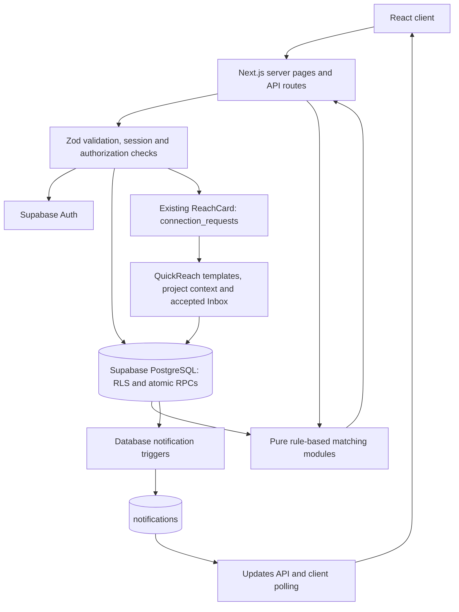

# Ramblin' Reach

Turn a Georgia Tech student's project problem into a useful conversation and a recorded next step.

Built for the Georgia Tech Campus Solutions Hackathon 2026.

## 💡 Why we built this

Alumni networks often feel like directories. Students cold message strangers with little context, while alumni get little reason to say yes. A student can lose weeks on a problem someone in the network has already solved.

We wanted the starting point to be what someone is building, where they are stuck, and what kind of help would move them forward.

## 🔁 The idea

A network built around student projects, with learning in both directions. Students can ask for guidance, and alumni can ask students to teach them something new.

**Problem → Community → Relevant Person → Conversation → Action → Outcome**

The app has three core capabilities: **JacketPath** for source-backed next steps, **JacketMatch** for finding relevant people and Circles, and **ReachCard** for reviewed requests and accepted conversations.

## ✨ What makes it different

- Projects give a connection context: the challenge, work already done, and specific help needed.
- Every match explains itself using stored skills, interests, experience, or learning preferences.
- Alumni learn too through Can teach / Want to learn fields and Learning Requests.
- Students review requests before sending. Learning Logs, private Impact Cards, and Help Chains preserve self-reported outcomes afterward.

## 🌱 Intended impact

Students should spend less time finding the right person and more time making progress. Alumni should receive focused requests that respect their capacity, and have a way to learn from current students. Clubs could retain useful lessons as members graduate.

This has not been piloted with real users yet. There are no adoption or impact metrics, and no real-user data exists yet. Demo outcomes are simulated sample records.

## 🛠️ What it can do

| Feature | What happens |
| --- | --- |
| JacketPath | Saves a goal and checklist using five curated official resources, review dates, and access caveats. |
| JacketCircles, within JacketMatch | Verified members discuss Hackathons, Startups, Personal Projects, Research, Clubs & Organizations, and Careers. |
| Post types | Ask for Help, Building Something, Looking for Teammates, Project Feedback, Project Update, and Learning Request. |
| Resolve | A post owner marks a discussion resolved; resolved discussions reject further replies. |
| Explainable matching | Stored signals produce reason lines; company and city filters use their intersection. |
| QuickReach, within ReachCard | Editable templates for Career Question, Coffee Chat, Resume Review, Mock Interview, Project Feedback, Technical Mentoring, General Connection, and Quick Question. Review and confirmation precede sending. |
| Inbox | Accepted ReachCards unlock participant-only text conversations with polling and unread indicators. |
| Notifications | Persistent in-app updates for requests, acceptance, messages, replies, and matched requests, with deep links and mark-read. |
| Learning Exchange | Matches project help and reciprocal teach/learn interests; alumni can publish Learning Requests. |
| Learning Log | Each participant records learned/helped/next-step text. Explicitly shared fields can appear on profiles or projects. |
| Built at Tech | Alumni optionally record a project title, year, and lab or club; matching uses title words, never graduation assumptions. |
| Available now | Alumni opt into a server-owned 60-minute window, with an expiring badge and People filter. This is not live presence. |
| Impact Card | The profile owner sees a private summary derived from completed requests and their recorded outcomes. |
| Help Chain | A private SVG on the owner's profile shows recorded help relationships without publishing counterpart attribution. |

## 🧩 Architecture and system design

One Next.js App Router application serves React pages and API routes. Cookie-based Supabase Auth identifies the member. Zod validates boundaries; server checks and PostgreSQL RLS/RPCs enforce permissions. Application runtime does not use a service-role client.



ReachCard was extended rather than replaced: `connection_requests` remains the conversation identity. `request_messages` stores messages, `request_reads` tracks read cursors, and `outcomes` also supplies the Learning Log.

### Core request flow

1. A member saves a project through `/api/projects` into `member_projects`, then posts a blocker through `/api/circles` into `circle_posts`. Optional JacketPath starts at `/api/goals`, persisting `goals` and `path_steps`.
2. `/circles` and `/circles/[id]` show permitted posts and `circle_comments`. Project and learning surfaces use deterministic matching; `/api/people` provides filtered directory results from opted-in profiles and projects.
3. `/people/[id]/request` opens reviewed QuickReach. `/api/requests` calls `create_connection_request`, or `create_project_reachcard` for owned project context, to insert a pending `connection_requests` row under atomic quota checks.
4. The recipient accepts through `/api/requests/[id]`. `/requests` and `/requests/[id]` unlock the thread; `/api/requests/[id]/messages` reads/writes `request_messages` and tracks `request_reads` through RPCs.
5. A participant completes the request and records an outcome through `/api/requests/[id]/outcomes`. `outcomes` stores each reporter's Learning Log; explicit sharing makes selected fields available on profiles/projects.
6. Database triggers persist `notifications`; `/api/notifications` supplies authorized updates and mark-read. `/profile` derives private Impact Cards and Help Chain from completed requests and recorded outcomes.

### Data model

| Entity | Purpose | Key relations |
| --- | --- | --- |
| `profiles` | Membership, visibility, skills, help capacity, teach/learn and alumni context | Supabase Auth user ID; owns projects and posts |
| `membership_requests`, `blocks` | Manual verification requests and member exclusions | Profile owners / blocked profile pairs |
| `resources` | Curated official source records | Referenced in path source snapshots |
| `goals`, `path_steps` | Saved intentions and checklist progress | Goal owner; steps belong to a goal |
| `member_projects` | Project context, lessons and explicit visibility | Owner profile; linked posts and requests |
| `circle_posts`, `circle_comments` | Categorized discussion and one reply level | Post owner, optional project; comment post/parent |
| `connection_requests` | ReachCard content and lifecycle | Requester, recipient, optional goal/project |
| `request_messages`, `request_reads` | Accepted conversation and unread cursors | Request and participant |
| `outcomes` | Private reports and opt-in learning fields | Request + reporter; optional owned project |
| `notifications` | Persistent event updates | Recipient, actor, optional request/post |
| `reports`, `circle_reports` | Member-submitted safety reports | Reporter and target request/post/comment |

### Matching

Matching is rule-based on purpose so every match is explainable. Directory ranking and Learning Exchange use separate pure modules. They use stored facts, deterministic ordering, and explicit time inputs for expiring availability, without AI compatibility percentages.

| Signal | How it affects ranking and the reason line |
| --- | --- |
| Shared skills/tags | Normalized overlaps with skills/project tags; directory says “Shared project skills”; exchange says “Shared skills”. |
| Category | An opted-in mentor category adds exchange relevance and “Interested in [category]”. |
| Opted-in interests | Exact normalized overlap adds exchange weight and “Shared interests: [tags]”. |
| Service availability | Pause, offered topics, and committed monthly usage gate request availability; topic fit yields “Offers [topic]”. Available now is an optional expiring filter/badge. |
| Teach/learn overlap | Each overlap has weight 4; explains “Can teach what you want to learn” or “Wants to learn what you can teach”. |
| Built at Tech | Exact title-word overlap adds 3 and a self-reported title/year/lab reason; year does not affect rank. |
| Company, city, GT context | Intent-specific directory weights; reasons explicitly identify self-reported employer, location, or shared GT context. |

Exchange weights shared skills by 3, interests by 2, and category by 1. Directory ranking uses intent-specific topic, skill, company, city, GT context, and capacity weights, then stable tie breaks. A company match never promises a referral.

### Authorization

| Content | Who can read or write | Server-side enforcement |
| --- | --- | --- |
| Posts and replies | Eligible verified members under visibility/block rules; owners manage their content | Session guards, validated APIs, RLS and database mutation checks |
| Requests and threads | Request participants only; messaging requires accepted status | Participant checks, RLS and transactional RPCs; blocks/withdrawal revoke access |
| Notifications | Only the recipient reads and marks read; clients cannot create events | API checks, recipient RLS, database triggers |
| Outcomes | Participants access private records; each records their own outcome after completion | API validation, RLS and DB guards; narrow shared-log RPC exposes only consented fields |

### Messaging and request states

`pending → accepted` or `declined` is the recipient's choice. The requester can cancel a pending or accepted request. An accepted request becomes `completed` through Complete/Close by a participant. The UI's closed conversation uses this existing completed state; there is no separate `closed` database status.

Only accepted requests accept new messages. Completed conversations are read-only; declined requests never unlock messaging. UUID retry keys reconcile retries, and a request row lock serializes messages against closing.

## 🔒 Security and privacy

Server-side authorization accompanies RLS. Sensitive writes use restricted database RPCs, including atomic request quotas and message limits. Mutations check origin, JSON shape and body size. Message sends are limited to ten new messages per member per minute.

User content renders as plain text. Project URLs are validated, including unsafe scheme/private-address rejection, and are not fetched by the server. Member-facing responses exclude emails, phone numbers, precise addresses, scheduling links, and private project artifacts. API error logging avoids submitted private text. Members can block others and report content.

Stored data includes Auth credentials managed by Supabase, profile fields and consent, project/post/reply text, goals and progress, request briefs, messages, read cursors, outcome notes and sharing choices, notifications, blocks, and reports. Private notes do not automatically become shared lessons. Employment and outcomes are self-reported; alumni approval is manual, not inferred from graduation year or email domain.

## ✅ What's real

These are recorded local results from [DEVPOST_FACTS.md](DEVPOST_FACTS.md) and [PLAN.md](PLAN.md), not a claim that the full suites were rerun for this README update.

| Check | Measured result |
| --- | --- |
| Unit tests | 81 passed across 15 suites, including 10 availability/Built at Tech/Impact cases. |
| Database/RLS/concurrency | 103 passed: 51 transactional, 6 concurrency/month-boundary, 11 Circles, 16 Inbox, 19 learning-loop checks. |
| Browser regression | Full run: 30 passed, 2 locator failures. Both corrected cases passed on targeted rerun; 32 distinct cases passed across those runs. No second full run. |
| End-to-end demo loop, DM01 | 2 passed, desktop and 375 px mobile, using real Auth and persisted simulated outcomes. |
| Layout and accessibility | Dashboard, People, Inbox and Profile verified at 375, 390, 428, 768, 1024 and 1440 px with overflow assertions and axe scans. This does not certify every route. |

There is no real-user data yet. No hosted deployment, campus adoption, production security certification, or complete WCAG certification is claimed. Historical [release evidence](RELEASE_REPORT.md) predates the later learning and notification extensions.

## 🚀 Quick start

Use Node 24, npm, Docker Desktop, and an isolated local Supabase instance.

```sh
npm ci
npx supabase start
npx supabase migration up --local
```

Copy `.env.example` to `.env.local`. Runtime variable names: `NEXT_PUBLIC_SUPABASE_URL`, `NEXT_PUBLIC_SUPABASE_PUBLISHABLE_KEY`, `APP_ENV`, `DEMO_MODE`, `MOCK_AI`, `NEXT_PUBLIC_APP_URL`. Optional legacy parser names: `OPENAI_API_KEY`, `OPENAI_MODEL`; no active AI service is required.

For seeding, copy `.env.seed.example` to `.env.seed.local`: `APP_ENV`, `ALLOW_DEMO_SEED`, `SUPABASE_URL`, `SUPABASE_SERVICE_ROLE_KEY`, `DATABASE_URL`. Keep operator credentials out of application runtime and version control.

```sh
npm run dev
npm run build
npm run typecheck
npm run check
npm run test:db
npm run test:e2e
```

`check` runs typecheck, lint and unit tests. Database tests require the isolated local database. Browser tests build/start a production server and need port 3000 free. Prepare regression fixtures with `npm run db:seed` and install Chromium with `npx playwright install chromium`. See [local setup](docs/LOCAL_SETUP_AND_SECURITY.md).

## 🎭 Try the demo

Enable `DEMO_MODE` locally and explicitly authorize seed operations with `ALLOW_DEMO_SEED`. Production rejects demo mode; local demo switching never bypasses authentication.

```sh
npm run demo:seed
npm run dev
# Restore the sample scenario later:
npm run demo:reset
```

Open `/demo` to choose among three student and four alumni personas. The server signs into a real Supabase account. Generated credentials stay in ignored `.tmp/reach-demo-accounts.json` and are not returned to the browser.

Everything in this scenario is seeded sample data. Reset restores fixed scenario content while preserving Auth identities and unrelated accounts; it refuses interactions outside its namespace. `/demo` also offers reset for a registered demo session. The switcher is local-only and returns 404 when disabled. See [DEMO.md](DEMO.md) for the walkthrough.

## 🧭 Limits and what's next

No scraping, job ingestion, contact importing, multi-university directory, attachments, global social graph, or autonomous third-party actions. Read selections are bounded. Available now is an expiring opt-in signal, and employers/outcomes remain self-reported.

Potential next steps are email notifications and digests, consent-based calendar scheduling, a separately designed referral workflow, and pilots with Georgia Tech clubs and the alumni association. None is built or an established partnership. A pilot should measure relevance, response burden and useful next steps before claiming impact.

## ⚙️ Tech stack

- Next.js 16.4.6 App Router, React 19, strict TypeScript; Webpack builds.
- Supabase Auth, PostgreSQL, RLS, and transactional RPCs.
- Zod, Tailwind CSS, Radix Slot, Lucide icons.
- Vitest, Playwright, axe-core, ESLint, and local Supabase CLI.

Ramblin' Reach is an independent student project and is not affiliated with or endorsed by Georgia Tech.
